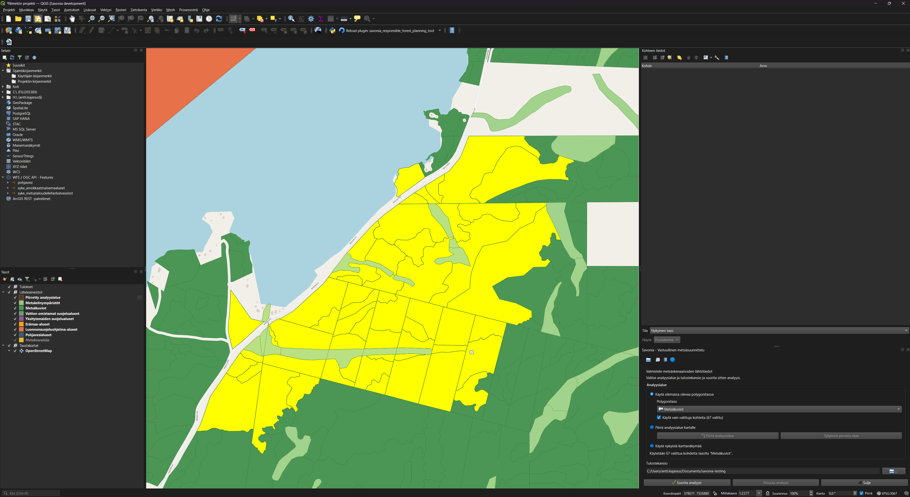
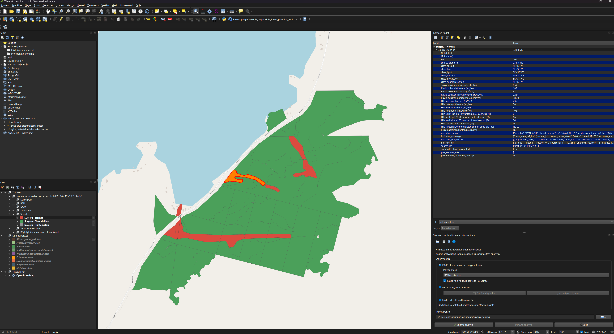

# Savonia - Responsible Forest Planning — Personal Prototype

Project names: **Savonia - Responsible Forest Planning** (English) and
**Savonia - Vastuullinen metsäsuunnittelu** (Finnish). The plugin, its metadata,
help and output provenance use the corresponding name for the selected language.

**This is my unfinished personal training project**, an independent prototype by Antti Kajanus based on the real forest-planning use case described in Savonia's project and procurement materials. **Neither this prototype nor its results are finalized, official, backed, endorsed, or approved by Savonia in any form.** The design reflects my limited understanding of the intended solution and my own assumptions and interpretations; it does not represent Savonia's implementation or accepted requirements.

## Savonia's forest-planning project

Savonia's **Vastuullista metsäsuunnittelua kuntametsänomistajille** project
developed a way for municipalities to compare forest-management choices across
economic, carbon, biodiversity, water and recreation objectives, using
Siilinjärvi as a case. The aim is to help forest owners and decision-makers
weigh different goals when deciding how their forests should be managed.

The approach uses a **value table (arvotaulukko)** to compare alternative
management pathways and their modeled effects. It brings together spatial
evidence, a separate calculation model, field assessment and dialogue with
forest owners and the public. The follow-on **Vastuullisen metsänhoidon
roadshow** project was designed to bring this approach to more municipalities
and parishes. See [project context](docs/project-context.md#external-use-case)
for the background and source summaries.

### Project material

- [Savonia project record](https://www.savonia.fi/tki-ja-palvelut/tutkimus-ja-kehittaminen/paattyneet-projektit-ja-hankkeet/?id=1960) — the original municipal forest-planning project.
- [Planning method](https://vastuullinenmetsasuunnittelu.savonia.fi/metsasuunnitelma/) and [method guide (PDF)](https://laari.info/wp-content/uploads/2026/05/vastuullisen-metsasuunnittelun-opas.pdf) — the value-table approach and wider planning process.
- [Dataset catalogue](https://vastuullinenmetsasuunnittelu.savonia.fi/paikkatietoaineisto/) — spatial datasets and their original providers.
- [Roadshow project record](https://hankkeet.savonia.fi/tutustu/kaynnissa-olevat-hankkeet/?id=2438) — the follow-on project for municipalities and parishes.

### Procurement references

The related [procurement 629864, Paikkatietotyökalu](https://tarjouspalvelu.fi/UX/TP/SiirryTarjouspyyntoon/?tpId=629864)
describes a QGIS tool for preparing classified geography and forest-input
tables; development of the separate calculation model is excluded.
The local materials are the [tender report](docs/bid/TarjouspyyntoRaportti629864.pdf),
[project description (Annex 1)](docs/bid/liite1_hankkeenkuvaus.pdf) and
[procurement scope (Annex 2)](docs/bid/liite2_hankinnankohteenkuvaus.pdf).
The complete material and clarifications require access to the authenticated
procurement portal. See [project context and procurement references](docs/project-context.md#procurement-reference-and-authority)
for source limitations.

## How this prototype fits in

This repository explores the **spatial evidence preparation** part of that
process. Its QGIS plugin combines Metsäkeskus forest stand and inventory grid
data with SYKE environmental data for a selected area. It classifies forest
polygons as sensitive or economic across six cumulative sensitivity tiers and
summarizes descriptive forest indicators, such as timber volume, growth,
age structure and peatland area.

The results are **classified forest polygons in a GeoPackage** and
**indicator summaries in an Excel workbook**, with source snapshots, coverage
and provenance for review. These are inputs for a separate value-table model
to compare management scenarios. The prototype does not calculate scenario
impacts, prescribe forest management, determine legal harvesting rights or
replace field assessment. Its workbook is not a completed value table, and
the prototype does not claim to fulfill the procurement requirements.

## What the analysis does

The analysis clips source data to the selected area, splits forest stands at
sensitivity boundaries and classifies the resulting polygons across six
cumulative tiers. A qualifying Forest Act Section 10 habitat affects the whole
clipped parent stand; other criteria affect the overlapping pieces.

Stand and grid indicators remain separate estimates, with source and metric
coverage reported alongside the results. Missing numeric evidence can leave
indicators unavailable or partial. Required-source failures and unrecognized
classification values stop the run before outputs are published. The results
support planning and do not determine legal harvesting rights.

See the [classification and calculation rules](docs/architecture/calculations.md),
[indicator definitions and limitations](docs/architecture/indicators.md), and
[source requirements](docs/architecture/source-layer-requirements.md) for the
tier criteria, overlap thresholds, formulas and treatment of missing data.

## Installation

The plugin is **experimental** and targets **QGIS 4.2.3 and newer 4.x releases**.
QGIS 4.2.3 is the current verification baseline; later releases need runtime
checks as they become available. Building the ZIP
uses Windows PowerShell; analysis needs an internet connection to the configured
Metsäkeskus and SYKE WFS services. The interface and new outputs use Finnish when
QGIS uses Finnish, and English otherwise.

1. Download or clone the **complete repository**, including `docs/help/`.
   With Git installed, run these commands in Windows PowerShell:

   ```powershell
   git clone https://github.com/anttikajanus/savonia-responsible-forest-planning-tool.git
   Set-Location savonia-responsible-forest-planning-tool
   ./qgis_plugin/package.ps1
   ```

   For an existing checkout, run only the packaging command from its root.
   It prints the ZIP path under `qgis_plugin/dist/`, includes both manuals,
   and preserves the plugin version.
2. In QGIS, open **Plugins → Manage and Install Plugins → Install from ZIP**,
   select the printed ZIP and enable **Savonia - Responsible Forest Planning**
   (**Savonia - Vastuullinen metsäsuunnittelu** in Finnish).
3. Open the plugin from its toolbar. Use **Help** to check that the installed
   manual opens.

See the [installation guide](qgis_plugin/README.md#runtime-and-installation)
for details or the [development guide](docs/architecture/development.md) for a
source-linked setup. Packaging preserves the metadata version by default;
add `-BumpMinor` only when intentionally preparing a new version.

## First run

1. In the wizard toolbar, choose **Set up forest planning layers**.
2. At the SYKE prompt, enter a provider-issued `sykeuserid` or leave it blank
   to continue. The plugin accepts a blank value, but **SYKE requires an
   application-specific identifier for long-term application use or intensive
   requests**. See [SYKE setup](qgis_plugin/README.md#requirements-and-syke-setup)
   for the provider's instructions. When supplied, the identifier is included
   in layer URLs and saved QGIS projects; review those URLs before sharing a
   project. Wait for all **eight required source layers** to report ready.
3. Start with a small area: draw a polygon, select polygon features from a
   project layer, or use the current map extent.
4. Choose a writable output folder and run the analysis. Resolve any reported
   source, geometry or validation error before retrying.
5. Inspect the classified layer in **Results**, then open the GeoPackage and
   workbook described below. Check source and metric coverage alongside the
   classifications and indicators.

The full manuals are available in [English](docs/help/manual_en.html) and
[Finnish](docs/help/manual_fi.html), and through the plugin's offline Help.

### Screenshots

These examples show the Finnish interface. Open the images to inspect them at
full resolution.



**Selecting the analysis area.** The 67 selected forest stands are highlighted
in yellow. The dock on the right uses the existing polygon layer with
**Käytä vain valittuja kohteita** (use only selected features) enabled; the
output folder is set below the area controls.



**Reviewing the results.** The **Suojelu** (Protection) tier shows sensitive
polygons in red and economic polygons in green. The Results group on the left
contains the tier views and source snapshots. The identified polygon is
highlighted on the map, with its classifications, indicators and source
identifiers shown in the upper-right panel.

## Expected outputs

A successful run writes two files with the same basename. The wizard generates
a name beginning `savonia_responsible_forest_inputs_`; Processing also lets you
choose an output basename. Existing output files are never overwritten.

| Output | Contents | What to inspect first |
| --- | --- | --- |
| `<basename>.gpkg` | `classified_forest_polygons`, clipped source snapshots, `source_coverage` and `run_metadata` | The six tier classifications, source/rule identifiers, indicator statuses and coverage |
| `<basename>.xlsx` | Tier/class summaries, source coverage, metric coverage and calculation notes | Sensitive/economic areas, valid and unknown hectares, source dates and limitations |

Both files retain data-source attribution and run provenance. The reporting
area is the forest represented by the classified stand polygons; land outside
those stands is not automatically included. Spatial outputs use EPSG:3067;
areas are planar hectares.

## Development setup

After cloning the complete repository, run the reference downloader from the
repository root with Python 3.10 or newer:

```powershell
python scripts/download_references.py
```

If Python is available through your Windows QGIS installation, use its launcher:

```powershell
& 'C:\Program Files\QGIS 4.2.3\bin\python-qgis.bat' scripts/download_references.py
```

This populates `docs/references/` with WFS capabilities, layer schemas and
provider PDF/XLSX documentation so developers and agents can read them locally.
Downloaded files and retrieval metadata are ignored by Git; the README and
source manifest stay versioned. Repeated runs reuse valid cached files. Add
`--refresh` when you want to update them.

See the [reference instructions](docs/references/README.md) for source selection
and SYKE configuration, then follow the
[development guide](docs/architecture/development.md) for the QGIS development
profile and testing setup.

## Report an issue or contribute

Use [GitHub Issues](https://github.com/anttikajanus/savonia-responsible-forest-planning-tool/issues)
for bug reports and enhancement requests. Include the plugin and QGIS versions,
application language, steps to reproduce, expected and actual results, and any
reported run ID or failed stage. Share a small synthetic or sanitized example
when possible; remove identifiers and unnecessary personal/source data from
project URLs, logs and screenshots.

For a pull request, link the related issue and describe the change and checks
performed. Follow the [development and testing guide](docs/architecture/development.md),
run the checks relevant to the change, and verify Finnish and English for
user-facing changes. The project software uses the [MIT License](LICENSE);
third-party software and data retain their [own terms and credits](OPEN_SOURCE_ACKNOWLEDGEMENTS.md).

## Project contents

- [Local source references](docs/references/README.md) — run `python scripts/download_references.py` once to cache WFS capabilities, layer schemas and provider PDF/XLSX documentation for offline reading. Downloads stay out of Git; the manifest and downloader are versioned.
- [User stories and specifications](docs/specs/README.md) — current product scope, user goals, behavior and acceptance requirements.
- [Agent guidance and documentation map](docs/agents/README.md) — documentation ownership and task instructions.
- [Open-source licences and acknowledgements](OPEN_SOURCE_ACKNOWLEDGEMENTS.md) — software dependencies, upstream licence references, and data-source credits.
- [`qgis_plugin/README.md`](qgis_plugin/README.md) — plugin installation and documentation entry point.
- [`docs/architecture/development.md`](docs/architecture/development.md) — practical QGIS plugin development, reload, and debugging guide.
- [`docs/architecture/calculations.md`](docs/architecture/calculations.md) — documented calculation rules and indicator definitions.
- [Architecture and ADRs](docs/architecture/README.md) — adopted design decisions, source evidence, technical guidance and remaining questions.
- [Project context](docs/project-context.md) — source use case, procurement references and project scope.
