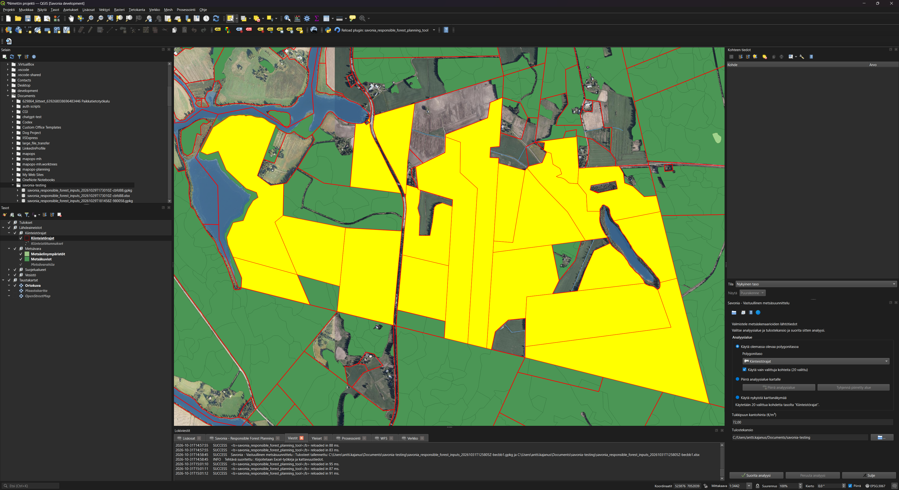
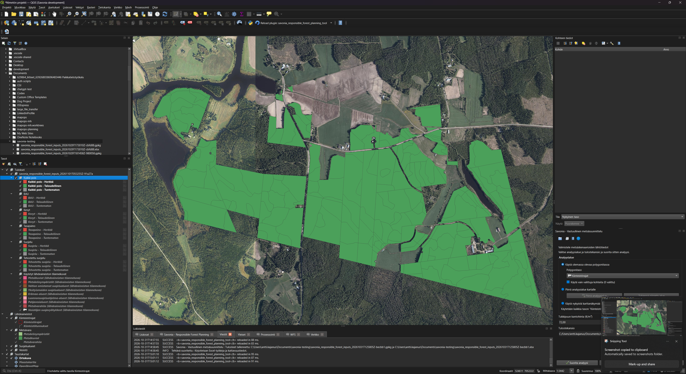
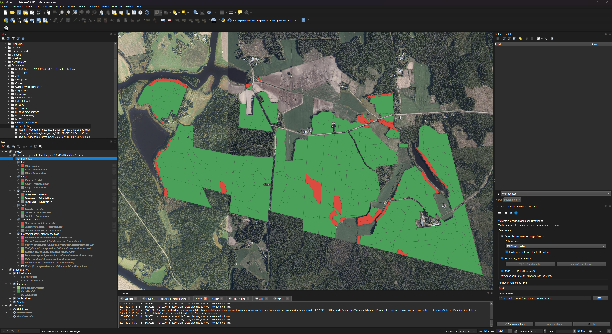
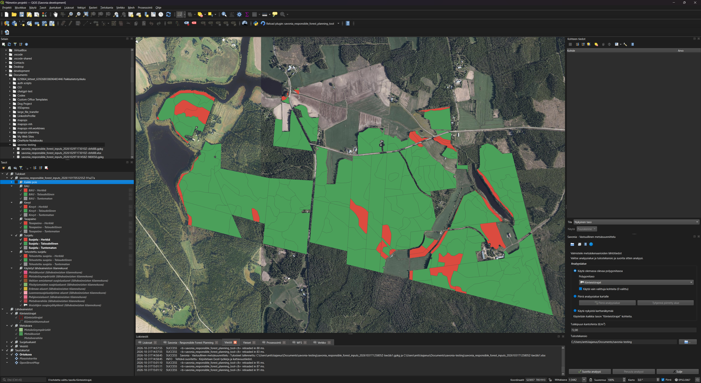
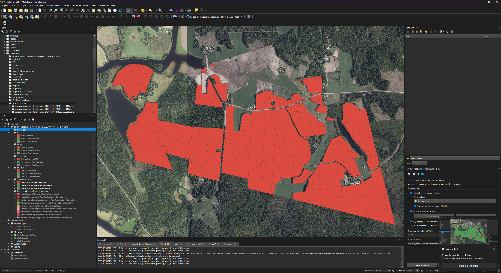
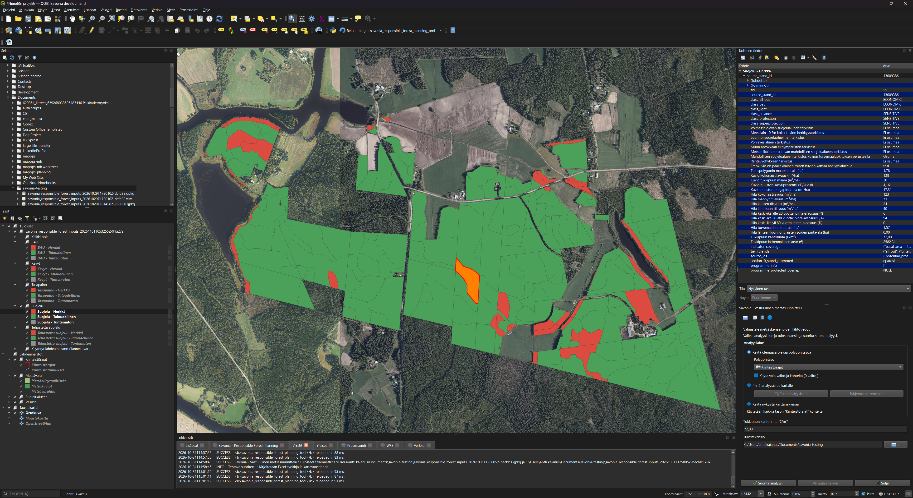
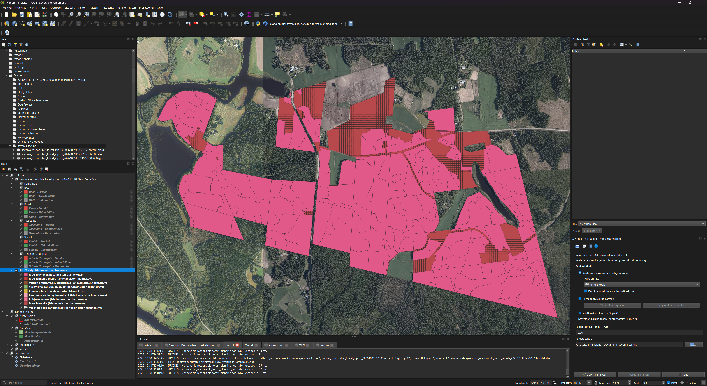

# Savonia - Responsible Forest Planning — Personal Prototype

Project names: **Savonia - Responsible Forest Planning** (English) and
**Savonia - Vastuullinen metsäsuunnittelu** (Finnish). The plugin, its metadata,
help and output provenance use the corresponding name for the selected language.

**This is my unfinished personal training project**, an independent prototype by Antti Kajanus based on the real forest-planning use case described in Savonia's project and procurement materials. **Neither this prototype nor its results are finalized, official, backed, endorsed, or approved by Savonia in any form.** The design reflects my limited understanding of the intended solution and my own assumptions and interpretations; it does not represent Savonia's implementation or accepted requirements.

Read the [project context](docs/project-context.md) for Savonia's original
project and follow-on roadshow, the value-table planning method, project and
procurement source materials, and this prototype's relationship to them.

## Savonia's forest-planning project

Savonia's municipal forest-planning approach uses a **value table
(arvotaulukko)** to compare management choices across economic, carbon,
biodiversity, water and recreation objectives. Spatial evidence supports a
wider process involving a separate calculation model, field assessment and
dialogue with forest owners and the public.

The [reference index](docs/references/README.md) lists the original procurement
documents and provider reference material.

## How this prototype fits in

This repository explores the **spatial evidence preparation** part of that
process. Its QGIS plugin combines Metsäkeskus forest stand and inventory grid
data with SYKE environmental data for a selected area. It classifies forest
polygons as sensitive or economic across six cumulative sensitivity tiers and
summarizes descriptive forest indicators, such as timber volume, growth,
age structure and peatland area.

The results are **classified forest polygons in a GeoPackage** and
**indicator summaries in an Excel workbook**, with source snapshots, coverage
and provenance for review. These are inputs for a separate value-table model
to compare management scenarios. The prototype does not calculate scenario
impacts, prescribe forest management, determine legal harvesting rights or
replace field assessment. Its workbook is not a completed value table, and
the prototype does not claim to fulfill the procurement requirements.

## What the analysis does

The analysis clips source data to the selected area, splits forest stands at sensitivity boundaries and classifies the resulting polygons across six cumulative tiers. A qualifying Forest Act Section 10 habitat affects the whole clipped parent stand; other criteria, including the adopted Ranta10 30 m riparian-buffer criterion, affect only qualifying result pieces.

Stand and grid indicators remain separate estimates, with source and metric
coverage reported alongside the results. Missing numeric evidence can leave
indicators unavailable or partial. Required-source failures and unrecognized
classification values stop the run before outputs are published.

See the [classification rules](docs/specs/classification.md),
[indicator calculations](docs/architecture/indicator-calculations.md),
[indicator definitions and limitations](docs/architecture/indicators.md), and
[source requirements](docs/architecture/source-layer-requirements.md) for the
tier criteria, overlap thresholds, formulas and treatment of missing data.

## Plugin installation

The experimental plugin targets **QGIS 3.44 and newer 3.x/4.x releases**.
Follow the [Plugin installation guide](qgis_plugin/README.md#plugin-installation)
to download the release ZIP, install it in QGIS and check that Help opens.
Analysis needs an internet connection to the configured Metsäkeskus and SYKE
WFS services. Project setup also connects to Maanmittauslaitos (MML) services
and requires an MML API key. Prepare the
[API key and user identifier](#get-the-api-key-and-user-identifier) before setup.

To build a ZIP from source or set up a development environment, use the
[development guide](docs/architecture/development.md).

## First run

### Get the API key and user identifier

Prepare these before setting up the layers:

| Provider | When needed | How to obtain it |
| --- | --- | --- |
| Maanmittauslaitos (MML) API key | Required for project setup: property boundaries, property identifiers and MML basemaps. | Register or sign in to **OmaTili** and create a key, following the [MML API-key instructions](https://www.maanmittauslaitos.fi/rajapinnat/api-avaimen-ohje). |
| SYKE application identifier (`sykeuserid`) | SYKE requires an application-specific identifier for long-term application use or intensive requests. The plugin accepts a blank value and lets you supply it later. | Request an identifier from **gistuki@syke.fi**, following the [SYKE identifier instructions](https://www.syke.fi/fi/ymparistotieto/avoimet-rajapinnat/paikkatietorajapinnat). |

The plugin remembers both values separately in QGIS settings. It uses the MML
key as the layer connection username with an empty password, and includes the
SYKE identifier in service URLs. **Saved QGIS projects retain both values**;
review layer connections and URLs before sharing a project. To replace a
rejected or changed MML key, change or clear
`savonia-forest-planning/mml-api-key` in QGIS's Advanced Settings Editor, then
repeat setup.

### Set up layers and run an analysis

Setup adds **16 layers**: eleven analysis sources (three Metsäkeskus and eight
SYKE), two MML property layers (boundaries and identifiers), and three basemaps
(Orthophoto, Topographic map and OpenStreetMap).

1. In the wizard toolbar, choose **Set up forest planning layers**.
2. At the **MML API key** prompt, enter your key. A saved key is
   reused on later setups. Cancelling or leaving the key blank stops setup
   before any layers change.
3. At the SYKE prompt, enter your `sykeuserid` or leave it blank to continue.
   Wait for all layers to report ready.
   If MML setup is incomplete, check the key and network connection, then repeat setup.
4. Start with a small area: draw a polygon, select polygon features from a
   project layer, or use the current map extent. See the
   [large-area limitation](#known-limitations) before attempting a larger run.
5. Enter a positive sawlog stumpage price (€/m³), choose a writable output folder
   and run the analysis. Resolve any reported
   source, geometry or validation error before retrying.
6. Inspect the classified layer in **Results**, then open the GeoPackage and
   workbook described below. Check source and metric coverage alongside the
   classifications and indicators.

The full manuals are available in [English](docs/help/manual_en.html) and
[Finnish](docs/help/manual_fi.html), and through the plugin's offline Help.
For toolbox, batch and model workflows, use the same analysis through
[Processing](docs/help/manual_en.html#processing).

### Screenshots

<details>
<summary>Show the Finnish interface: selection, results, identify and evidence</summary>

These captures show the Finnish interface, following selection → results →
identify → evidence. Open the images to inspect them at full resolution.

**1. Selection.** Twenty selected property parcels are highlighted in yellow.
The dock uses the **Kiinteistörajat** (property boundaries) polygon layer with
**Käytä vain valittuja kohteita** (use only selected features) enabled and a
sawlog stumpage price of **72 €/m³**.



**2. Results.** The **Tulokset** (Results) group contains the sensitivity tier
views. Sensitive polygons appear in red, economic polygons in green, and the
legend reserves grey for unknown classifications. These four views show the
same area across increasing sensitivity tiers.

**Kaikki pois (All out).** The result polygons in this example are economic.



**Tasapaino (Balance).** Sensitive pieces appear along water edges and within
some stands.



**Suojelu (Protection).** Additional forest polygons are classified as sensitive.



**Tehostettu suojelu (Superprotection).** All result polygons in this
example are sensitive.



**3. Identify.** Identifying a result polygon highlights it on the map and
shows its tier classifications, criterion checks, forest indicators and source
references in the **Kohteen tiedot** (Identify Results) panel.



**4. Evidence.** The **Käytetyt lähdeaineiston tilannekuvat** (used source
snapshots) group lets you inspect the data used in the analysis. Here, forest
stand snapshots appear in pink alongside the inventory grid and other source
evidence layers.



</details>

## Expected outputs

A successful run writes two files with the same basename. The wizard generates
a name beginning `savonia_responsible_forest_inputs_`; Processing also lets you
choose an output basename. Existing output files are never overwritten.

| Output | Contents | What to inspect first |
| --- | --- | --- |
| `<basename>.gpkg` | `classified_forest_polygons`, clipped source snapshots, one combined `buffered_water_evidence` layer, `source_coverage` and `run_metadata` | Six tier classes, criterion checks, riparian source references and buffer metadata, parent-overlap flags, and metric coverage |
| `<basename>.xlsx` | Tier/class summaries, source coverage, metric coverage and calculation notes | Sensitive/economic areas, valid and unknown hectares, source dates and limitations |

Both files retain data-source attribution and run provenance. The reporting
area is the forest represented by the classified stand polygons; land outside
those stands is not automatically included. Spatial outputs use EPSG:3067;
areas are planar hectares.

Stand overlaps remain untrimmed and can duplicate area and timber contributions;
a completion warning points to technical details. Calculated sawlog value uses
the supplied price and represented sawlog volume, with known/unknown coverage
preserved. It is not a total forest valuation.

See the [output examples](docs/examples/classified-forest-polygons.md) and
[output schema](docs/architecture/output-schema.md).

## Known limitations

The analysis retains source evidence and results in memory. Large areas can
exhaust memory and potentially crash QGIS; no safe area threshold has been
established. Start small and consult the
[memory-use limitation](docs/open-questions.md#large-area-memory-use).

Live-provider coverage and Finnish/English desktop acceptance still have
outstanding checks. The [open-question register](docs/open-questions.md)
owns current implementation gaps, provider questions and remaining acceptance.

## Development setup

Windows is the only supported development environment
([ADR-0020](docs/architecture/adr/0020-windows-only-development-environment.md)).
Start with the [development bootstrap](docs/architecture/development.md#development-bootstrap),
which prepares the developer tools and both pinned QGIS verification baselines.
Run it from the repository root:

```powershell
./scripts/setup-dev-environment.ps1
```

The [development guide](docs/architecture/development.md) owns prerequisites,
QGIS profiles, reload, debugging, checks and packaging commands. The
[script index](scripts/README.md) lists reusable entry points.

Before investigating provider contracts, follow the
[reference-cache instructions](docs/references/service-metadata/README.md) to
download schemas and model documents. The downloader uses its own environment
settings, including `MML_API_KEY` for authenticated MML references; the plugin's
saved QGIS key does not configure it.

## Report an issue or contribute

Use [GitHub Issues](https://github.com/anttikajanus/savonia-responsible-forest-planning-tool/issues)
for bug reports and enhancement requests. Include the plugin and QGIS versions,
application language, steps to reproduce, expected and actual results, and any
reported run ID or failed stage. Share a small synthetic or sanitized example
when possible; remove identifiers and unnecessary personal/source data from
project URLs, logs and screenshots.

For a pull request, link the related issue and describe the change and checks
performed. Follow the [development and testing guide](docs/architecture/development.md),
run the checks relevant to the change, and verify Finnish and English for
user-facing changes. The project software uses the [MIT License](LICENSE);
third-party software and data retain their [own terms and credits](OPEN_SOURCE_ACKNOWLEDGEMENTS.md).

## Project contents

- [External reference material](docs/references/README.md) — original procurement PDFs and the provider service metadata cache.
- [User stories and specifications](docs/specs/README.md) — current product scope, user goals, behavior and acceptance requirements.
- [Agent guidance and documentation map](docs/agents/README.md) — documentation ownership and task instructions.
- [Open-source licences and acknowledgements](OPEN_SOURCE_ACKNOWLEDGEMENTS.md) — software dependencies, upstream licence references, and data-source credits.
- [Architecture and ADRs](docs/architecture/README.md) — adopted design decisions, source evidence, technical guidance and remaining questions.
- [Project context](docs/project-context.md) — source use case, procurement references and project scope.
