# Classification and indicator semantics

**Savonia - Responsible Forest Planning is an unfinished personal learning
prototype by Antti Kajanus. Its rules and results reflect limited understanding
and personal assumptions; they are not official, finalized, backed, endorsed,
or approved by Savonia in any form.** These definitions describe the prototype's
calculations, not Savonia's accepted requirements.

The QGIS plugin prepares spatial inputs for Savonia's separate value-table
model. It does not calculate forestry impacts, approve prescriptions, or decide
legal harvesting rights. Current functional scope and source expectations are defined in
[the maintained specifications](../specs/README.md).

This reference owns exact classification, geometry, output-field, aggregation
and reporting rules. [Indicator design](indicators.md) records the evidence,
rationale and accuracy limits; [source-layer requirements](source-layer-requirements.md)
owns required and optional provider fields.

## Analysis workflow

The wizard and Processing Toolbox use the same workflow. The chart follows its
validation, retrieval, classification, and publication stages.

```mermaid
flowchart TD
    A[Wizard or Processing] --> B[Validate polygon AOI, CRS transform context, output name and destination]
    B --> C{AOI and outputs valid?}
    C -- No --> X[Stop and report stage error]
    C -- Yes --> D[Merge chosen AOI features; transform to EPSG:3067]
    D --> E[Validate all eight required WFS layers and required fields]
    E --> F{All required layers ready?}
    F -- No --> X
    F -- Yes --> G[Request AOI-bounding-box features from each WFS]
    G --> H[Transform, intersect with AOI, retain source IDs, feature counts and clipped snapshots]
    H --> I{Request, repair, geometry and overlay succeeded?}
    I -- No --> X
    I -- Yes --> J[Interpret active protected areas, habitat codes and programme classes]
    J --> K{All returned classification values recognized?}
    K -- No --> X
    K -- Yes --> L[Build recognized criterion geometries and record coverage]
    L --> M[For each AOI-clipped stand, split at intersecting criterion boundaries]
    M --> N{Stand overlaps positive area with recognized Section 10 habitat?}
    N -- Yes --> O[Mark every piece of that original stand as Section 10]
    N -- No --> P[Keep piece-level protected, programme and other-habitat matches]
    O --> Q[Assign six tier classes and matched rule/source IDs per piece]
    P --> Q
    Q --> R[Intersect grid with each result piece; calculate grid and stand indicators with metric coverage]
    R --> S[Prepare coverage, limitations and run metadata]
    S --> T[Write GeoPackage: classified results, clipped snapshots, coverage and metadata]
    T --> U[Aggregate workbook summaries by tier and class]
    U --> V[Write workbook; remove partial files if writing fails]
    V --> W[Return result layer and output paths]
    subgraph tier_rules[Per-piece tier rules]
      R1[All out and BAU: active protected area or Section 10]
      R2[Light: same triggers as All out and BAU]
      R3[Balance: Light triggers plus programme and groundwater areas]
      R4[Protection: Balance triggers plus other valuable habitat]
      R5[Superprotection: trigger is sensitive; otherwise remaining analyzed forest is sensitive]
      R6[No trigger: economic when required evidence is available; unknown when evidence is unavailable]
    end
    Q --- tier_rules
```



All eight required source layers across the analysis source groups must pass
validation before classification begins. The protected-area group contains
state-owned, private-land, and wilderness feature types. Missing required
source fields, failed requests, null, empty or unrepairable returned geometries,
overlay failures, and uninterpretable classification values stop the run. The
current workflow does not publish partial results for those failures. Criteria
outside the implemented scope are recorded as `OUT_OF_SCOPE` and do not affect classifications.

## Datasets used by the calculations

The tables below document the current implementation. Dataset names refer to
the configured source layers; a successful request does not certify complete
geographic coverage. Source fields are matched case-insensitively.

| Dataset reference | Provider and dataset | Source fields or geometry used | Service |
| --- | --- | --- | --- |
| Stand | Metsäkeskus forest stands, v2 `stand` | Stand polygons; `volume`, `sawlogvolume`, `volumegrowth`, `meanage`; optional `standid`, `basalarea` | [Stand WFS](https://avoin.metsakeskus.fi/rajapinnat/v2/stand/ows) |
| Grid | Metsäkeskus forest inventory grid, `v2:gridcell` | `GRIDCELLID`, `VOLUME`, `VOLUMEPINE`, `VOLUMESPRUCE`, `VOLUMEDECIDUOUS`, `AGE`, `SOILTYPE`, `DRAINAGESTATE`; optional `TREEDATADATE`, `UPDATETIME` | [Grid WFS](https://avoin.metsakeskus.fi/rajapinnat/v2/gridcell/ows) |
| Habitat | Metsäkeskus habitats, v2 `habitat` | Habitat polygons; `habitattype`, optional `habitatid` | [Habitat WFS](https://avoin.metsakeskus.fi/rajapinnat/v2/habitat/ows) |
| Protected | SYKE state-owned protected areas, private-land protected areas, and wilderness areas; all three layers are required | Polygons; `olotila`, `tyyppilyhenne` or `kohdetyyppi`; optional `kohdeid` or `lsaluetunnus` | [Protected-sites WFS](https://paikkatiedot.ymparisto.fi/geoserver/inspire_ps/wfs); feature types `PS.ProtectedSitesValtionOmistamaLuonnonsuojelualue`, `PS.ProtectedSitesYksityistenMaillaOlevaLuonnonsuojelualue`, `PS.ProtectedSitesEramaaAlue` |
| Programme | SYKE nature conservation programme areas | Polygons; `lsoaluetunnus`, `luokka`; optional `subtype`, `nimi`, `muutospvm`, `lisatieto` | [Programme-area WFS](https://paikkatiedot.ymparisto.fi/geoserver/syke_luonnonsuojeluohjelma_alueet/wfs) |
| Groundwater | SYKE groundwater areas, `syke_vhspohjavesi:VHS2022_Pohjavesi` | All returned polygon footprints; no class or subtype filtering | [Groundwater WFS](https://paikkatiedot.ymparisto.fi/geoserver/syke_vhspohjavesi/wfs) |
| AOI | User-defined analysis area, supplied by the wizard or Processing | Polygon geometry used to clip all source layers | Drawn polygon, project-layer features, or captured map extent |

The configured endpoints and feature types are defined in
[`adapters/sources.py`](../../qgis_plugin/savonia_responsible_forest_planning_tool/adapters/sources.py).
Required fields and normalization are documented in
[source layer requirements](source-layer-requirements.md).

## Area and geometry

The workflow accepts one polygon layer as the analysis area (AOI), using all
features or only selected features. Empty or invalid AOI geometry stops the
run. AOI and source geometries are transformed to EPSG:3067. Source polygons
are clipped to the AOI and the stand result polygons are split by the
boundaries of recognized sensitivity criteria. Invalid source polygon geometries
are repaired with QGIS `makeValid()` when that produces valid polygon components;
repairs are counted and reported. Null, empty, unrepairable, or failed transformed
and clipped geometries stop the run. Area in hectares is planar
EPSG:3067 geometry area divided by 10,000. No buffers or proximity distances
are applied.

Invalid AOI geometry stops the run. The source loader repairs invalid polygon
geometries where possible; an unrepaired or invalid clipped result, failed
coordinate transform, or failed overlay stops the run. Source candidates that
do not overlap the AOI are counted and excluded. Overlapping AOI features are
dissolved. Overlaps greater than 1 m² between distinct AOI-clipped stands stop
the run. Pairwise overlaps up to and including 1 m² are tolerated without trimming,
so their area may contribute to both stands' areas and indicators. Identical
repeated grid IDs/records are deduplicated; conflicting records of one ID or
overlaps between distinct cells stop publication. Shared edges are allowed.
A direct criterion hit requires overlap greater than `1` square metre in
EPSG:3067. Overlaps of exactly `1` square metre or less, including a shared
boundary or point, do not trigger sensitivity. Protected areas, programme
areas, and other valuable habitats mark only the overlapping output piece(s).
Section 10 uses the same overlap threshold, then promotes every output piece
from the original stand. The `1` m² threshold avoids hits from tiny edge
discrepancies between source datasets. The separate `1e-8` m² output-geometry
tolerance only discards negligible fragments when retaining split polygons; it
does not determine whether a criterion hit occurs.

## Classification

Each output polygon carries six language-neutral fields:
`class_all_out`, `class_bau`, `class_light`, `class_balance`,
`class_protection`, and `class_superprotection`. Values are `SENSITIVE`,
`ECONOMIC`, or `UNKNOWN`. `UNKNOWN` means evidence required for a no-hit was
unavailable; it is not a forest type or a numeric zero. Unrecognized returned
classification values stop the run.

The cumulative criteria are evaluated independently for each output piece. A
recognized positive match makes the tier `SENSITIVE`, even if another required
source is unavailable. Without a positive match, all sources required by that
tier must be `AVAILABLE` before a no-hit can be `ECONOMIC`; otherwise the result
is `UNKNOWN`. A successful source request with no AOI-clipped features is still
marked `AVAILABLE`, so an empty response currently permits a no-hit
classification. Feature counts describe returned data and do not establish
complete service coverage.

These dependency rules describe the pure classification policy. The application
workflow requires all eight sources and stops before publication on a required
source or interpretation failure; it does not publish a partial-source run using
these `UNKNOWN` rules. Missing numeric indicator evidence can still produce
partial or unknown metrics in a successful run.

The cumulative criteria are:

| Calculated field | Tier | Dataset dependencies | Calculation |
| --- | --- | --- | --- |
| `class_all_out` | All out | Protected + Habitat | `SENSITIVE` for active protected-area overlap or Section 10 stand promotion; otherwise `ECONOMIC` when dependencies are available, else `UNKNOWN`. |
| `class_bau` | BAU | Protected + Habitat | Same calculation as `class_all_out`. |
| `class_light` | Light | Protected + Habitat | Same calculation as `class_all_out`. |
| `class_balance` | Balance | Protected + Habitat + Programme + Groundwater | All out triggers plus programme-area or groundwater overlap; otherwise `ECONOMIC` when dependencies are available, else `UNKNOWN`. |
| `class_protection` | Protection | Protected + Habitat + Programme + Groundwater | Balance triggers plus other valuable habitat overlap; otherwise `ECONOMIC` when dependencies are available, else `UNKNOWN`. |
| `class_superprotection` | Superprotection | Protected + Habitat + Programme + Groundwater | Any recognized Protection trigger gives `SENSITIVE`; remaining analyzed forest also becomes `SENSITIVE` when dependencies are available, otherwise `UNKNOWN`. |

Light uses the same criteria as All out / BAU; Balance adds programme areas,
and Protection adds other valuable habitats. Superprotection is sensitive for
every analyzed piece when its required evidence is available, including pieces
with no matched criterion. If evidence is unavailable, an unmatched piece is
unknown. All out and BAU have identical criteria but separate fields.
Groundwater polygons from the SYKE WFS trigger Balance, Protection, and
Superprotection. All returned polygon footprints are used without filtering
groundwater class or subtype; source identifiers are retained. Other criteria
intentionally outside scope—including SYKE forest-sensitive water, peatland criteria,
water-protection buffers, recreation, potential protected sites, and MY plan
areas—are not requested or processed and do not affect tier assignments.

An active protected-area hit requires status `voimassa` and a recognized
category. Returned protected-area records with another or unrecognized status
or category currently stop classification as uninterpretable source values;
they are not silently ignored. Programme-area intersections trigger Balance
and above but are not proof of current legal protection. Publication requires a
recognized programme class and a nonempty identifier. The interpreter can build
a criterion for a recognized class without an identifier, but also reports that
record as uninterpretable, so the workflow stops before publishing it. Identifiers, class/subtype
metadata, and observed overlap with recognized established protected areas are
retained where available; subtype is optional.

The saved habitat WFS schema confirms `habitattype`. The Metsäkeskus GeoServer
workbook links this field to `elinymparistokuvion_tyyppi-v_1_0`, and the
provider's GeoPackage guide defines code 1 as an ML10 habitat, code 3 as other
valuable habitat, and code 5 as an ML10 habitat requiring ML20 corrective
measures. Codes 1 and 5 trigger Section 10; code 3 triggers other valuable
habitat. Any other returned habitat code currently makes source interpretation
fail, so it does not reach tier classification as an unknown no-hit. A
recognized Section 10 overlap (greater than `1` m²) promotes
every analyzed piece of the original stand. Boundary-only contact does not
trigger the rule. The promotion is a project classification assumption, not a
finding that the entire stand is legally a Section 10 habitat.

## Indicators and summaries

The reporting domain is **analyzed forest represented by classified polygons**,
separately partitioned by each tier, rather than automatically the entire AOI.
Peatland and natural-mire hectares use that same forest domain; open mires outside
analyzed stands require a later extension. Grid boundaries do not split results
or change sensitivity criteria and Section 10 stand promotion.

### Per-polygon fields

The QGIS attribute table, grouped attribute form, Excel summary columns and
metric-coverage rows follow the order below. Source-dependent display labels
start with **Kuvio / Stand** or **Hila / Grid**, followed by the attribute.
Machine field IDs remain stable for expressions and integrations. Identity and
tier classifications precede these values; coverage and provenance follow them.
The GeoPackage saves the localized aliases and form groups for reopening.

#### Result land area / Tuloksen maapinta-ala

**Pinta-ala (ha)** is the ground area of the actual result polygon, after clipping
and splitting: 1 ha = 10,000 m². **Puuston pohjapinta-ala (m²/ha)** is the sum of
tree-trunk cross-sectional areas at breast height per hectare of land. For
example, 20 m²/ha describes tree density; it does not mean a polygon has 20 m² of
land. Basal area comes from stand `basalarea`; land area comes from geometry.
The same explanation appears in Finnish and English in the result/stand form
tabs and the workbook's calculation notes.

| Field | Display meaning | Source and calculation |
| --- | --- | --- |
| `area_ha` | Tulospolygonin maapinta-ala / Result polygon land area (ha) | Actual result-polygon EPSG:3067 area / 10,000, independent of metric coverage. |

#### Stand tree indicators / Kuvio: puustotunnukset

| Field | Display meaning | Source and calculation |
| --- | --- | --- |
| `total_volume_m3_ha` | Kuvio kokonaistilavuus / Stand total volume (m³/ha) | Stand `volume`; weighted by actual result-piece hectares in summaries. |
| `sawtimber_volume_m3_ha` | Kuvio tukkipuun määrä / Stand sawtimber volume (m³/ha) | Stand `sawlogvolume`; result-piece-area weighted in summaries. |
| `growth_percent` | Kuvio puuston kasvuprosentti / Stand growth (%/year) | `100 × stand.volumegrowth / stand.volume`, requiring positive stand volume. |
| `basal_area_m2_ha` | Kuvio puuston pohjapinta-ala / Stand tree basal area (m²/ha) | Optional stand `basalarea`; result-piece-area weighted. Measures trunk cross-sectional area per hectare of land. |

#### Grid volumes / Hila: puuston tilavuudet

| Field | Display meaning | Source and calculation |
| --- | --- | --- |
| `grid_total_volume_m3_ha` | Hila kokonaistilavuus / Grid total volume (m³/ha) | Grid `VOLUME`; mean weighted by valid intersected hectares. |
| `pine_volume_m3_ha` | Hila männyn tilavuus / Grid pine volume (m³/ha) | Grid `VOLUMEPINE`; its own valid intersected-area mean, replacing stand proportions. |
| `spruce_volume_m3_ha` | Hila kuusen tilavuus / Grid spruce volume (m³/ha) | Grid `VOLUMESPRUCE`; its own valid intersected-area mean. |
| `deciduous_volume_m3_ha` | Hila lehtipuun tilavuus / Grid deciduous volume (m³/ha) | Grid `VOLUMEDECIDUOUS`; all source-classified deciduous trees, with its own valid-area mean. |

#### Grid age shares / Hila: ikäosuudet

| Field | Display meaning | Source and calculation |
| --- | --- | --- |
| `share_under_20` | Hila keski-ikä alle 20 vuotta: pinta-alaosuus / Grid mean age under 20: area share (%) | `100 × matching hectares with AGE < 20 / valid-age hectares`. |
| `share_20_80` | Hila keski-ikä 20–80 vuotta: pinta-alaosuus / Grid mean age 20–80: area share (%) | `100 × matching hectares with 20 ≤ AGE ≤ 80 / valid-age hectares`; both endpoints included. |
| `share_over_80` | Hila keski-ikä yli 80 vuotta: pinta-alaosuus / Grid mean age over 80: area share (%) | `100 × matching hectares with AGE > 80 / valid-age hectares`. |

#### Grid land areas / Hila: maa-alat

| Field | Display meaning | Source and calculation |
| --- | --- | --- |
| `peatland_area_ha` | Hila turvemaiden pinta-ala / Grid peatland area (ha) | Intersected hectares with grid `SOILTYPE` 60–67, as a total only with complete known soil classification. |
| `natural_mire_area_ha` | Hila lähteen luonnontilaisten soiden pinta-ala / Grid source-classified natural mire area (ha) | Intersected hectares with grid `DRAINAGESTATE = 6`, as a total only with complete known drainage classification. |

#### Unavailable indicators / Tunnusluvut, jotka eivät ole käytettävissä

This field has no implemented source and remains at the end of the indicators.

| Field | Display meaning | Source and calculation |
| --- | --- | --- |
| `stumpage_price_eur_m3` | Keskimääräinen kantohinta / Average stumpage price (€/m³) | Null, `OUT_OF_SCOPE`; no price source or weighting. |

### Comparing indicators and reporting precision

Both total-volume estimates retain separate columns, source IDs and statistics.
They are not blended, added together or substituted when one is unavailable.
Species means use their own valid-area denominators. When species coverage differs,
adding pine, spruce and deciduous means need not reproduce the grid total, even
when the represented cubic metres nearly agree. A stand total is a separate source
estimate and need not agree with either. Inspect each metric's coverage before
comparing values; never replace missing species values with zero to force agreement.
Stand growth always uses stand volume, never grid volume. Stand `meanage` remains
required by the retained schema contract, but age shares use overall grid `AGE`.

Published volume fields in QGIS and workbook summaries are rounded to whole
m³/ha, and hectares to 0.01 ha (100 m²), with exact halves rounded up. This affects
the exported numeric fields as well as their display. Other decimal results and
numeric workbook coverage statistics display two decimal places, using the viewer's
locale. The GeoPackage stores the QGIS field presentation so it applies on reopen.
Calculations, summary inputs, coverage JSON and coverage-sheet statistics retain
full precision; summary values are rounded only after aggregation. Age shares,
age coverage and feature counts remain whole numbers. Rounding can make component
fields differ from their displayed total or from geometry-derived areas, and a
very small positive value can round to zero. The reporting increments are not
measurement accuracy: see [the precision assessment](indicators.md).

### Exact intersections and volume means

For a result piece `P` and grid cell `G_i`, use EPSG:3067:

```text
A(P) = area(P) / 10000                      # reporting hectares
a_i(P) = area(P ∩ G_i) / 10000              # intersected hectares
valid_area_m = Σ a_i(P) with a valid value for metric m
represented_volume_m3 = Σ a_i(P) × value_im
mean_m = represented_volume_m3 / valid_area_m
unknown_area_m = A(P) - valid_area_m
```

Retain positive-area intersections above the `1e-8` m² geometry tolerance. A genuine
0.5 m² fragment contributes; edge/point contact does not. The criterion threshold
greater than 1 m² does not apply to indicators. Do not use nominal 256 m² cells,
cell centres, full touched-cell areas, source area attributes or unweighted means.
Per-hectare values remain unchanged densities within cells: multiply by intersected
hectares once. This allocates the source estimate uniformly within the cell; it
does not measure sub-cell variation or establish better accuracy.

For example, 64 m² at 100 m³/ha and 192 m² at 300 m³/ha represent 6.4 m³ over
0.0256 ha: **250 m³/ha**. Stand volume 200 on the same polygon remains
**Kuvio kokonaistilavuus = 200**, independently of **Hila kokonaistilavuus = 250**.

Volume and age inputs must be numeric, finite and nonnegative. Null, booleans,
text, negative and non-finite values are unavailable; numeric zero remains valid.
Missing species values are independent of total volume and are not inferred by
subtraction. No valid area gives null and `UNKNOWN_FIELD_OR_VALUE`. Some valid
area gives its mean with `PARTIAL` status and unknown hectares disclosed. Complete
valid coverage gives `AVAILABLE`. Detailed reasons and source/cell IDs remain
diagnostics. Tiny unknown-area differences within tolerance are clamped to zero;
larger negative unknown areas are invariant failures that stop publication.

For stand density values, valid area is the actual result-piece area and the
numerator is `stand_value × piece_area_ha`; missing values have zero valid area.
Do not use original uncut stand area or grid-covered area as the stand weight.
Growth remains `100 × increment / standing volume`; zero growth with positive
volume is valid. Provider definitions do not settle the estimate's exact period,
gross/net basis or timing; see [growth design and evidence](indicators.md#growth-percentage).

### Grid ages and categorical area totals

Age shares use **grid-cell mean age**, not stand counts or individual-tree age
distributions. Divide matching-band hectares by valid-age hectares, and disclose
valid/unknown age hectares and coverage of the full reporting area. No valid ages
gives three null/blank shares. Use original unrounded age to select a band.

Store/export age shares and age-coverage percentages as whole numbers, rounding
exact halves up: 62.5% becomes 63%. Display ages in years without decimals. Rounded
band shares can sum to 99% or 101%; this is presentation rounding. Areas and
sufficient statistics retain full precision; never aggregate rounded shares.

Recognized soil codes are 10, 11, 12, 20–24, 30–32, 40, 50, 60–67, 70 and 80;
peat codes are 60–67. Recognized drainage codes are 1, 2, 3, 6, 7, 8 and 9;
natural mire is 6. Codes must be numeric, finite, integral and recognized; null,
text, booleans, unrecognized codes (including 0) and fractions are unknown.
Recognized nonmatching codes contribute known zero. Soil and drainage are
independent; contradictory classifications are recorded as diagnostics.

Complete classification coverage permits matching-hectare totals, including a
known zero. Any unknown hectares leave the requested total null/blank with
partial/unknown status; observed matching hectares remain a **lower bound**.
A 64 m² match contributes 0.0064 ha; a 0.5 m² match contributes 0.00005 ha.
These source-date classifications do not certify ecological condition or add
peat/mire sensitivity criteria.

### Tier/class summaries and metric coverage

Combine full-precision sufficient statistics separately per tier/class:

- Density mean: summed represented m³ / summed metric-valid hectares,
  independently for grid total, stand total, pine, spruce, deciduous and sawtimber.
- Growth and basal area: summed area-weighted stand values / their valid
  result-piece hectares. Growth remains a mean of stand rates, not a new ratio
  of group growth and volume.
- Age share: 100 × summed band hectares / summed valid-age hectares, rounded
  after division. Age coverage uses full group reporting area.
- Peat/mire total: summed matching hectares only when the entire group reporting
  area has known classification; otherwise disclose lower bound and unknown area.
- Area: summed actual result-piece hectares regardless of metric coverage.
  Feature count counts pieces. Empty groups have zero area/count and null
  density/age values.

Two 1 ha pieces with grid-valid areas 0.25 ha at 100 and 1 ha at 300 give
**260 m³/ha**, with 1.25 valid ha and 0.75 unknown ha. Stand values 100 and 300
over the complete pieces give **200 m³/ha** over 2 valid ha. Full-piece weighting
of partial grid means would be wrong. If the first grid age is under 20 and the
second over 80, shares are **20%, 0%, 80%**, with exact age coverage 62.5%,
presented as **63%**.

`indicator_coverage` records each metric's `source_id`, `status`, `valid_area_ha`,
`unknown_area_ha` and sufficient statistics: `represented_volume_m3` for volume,
`weighted_sum` for stand rates/basal area and `matching_area_ha` for age/area
metrics. Age entries retain `coverage_percent_exact` and rounded
`coverage_percent`. The localized metric-coverage worksheet exposes tier/class,
metric, source, status, valid/unknown hectares and observed partial quantities.
Price is `OUT_OF_SCOPE`; its numeric field stays blank. Availability is recorded
in statuses and notes rather than appended to attribute names.

## Outputs and coverage

The GeoPackage contains one spatial result layer, AOI-clipped snapshots of the
returned WFS features, a `source_coverage` table, and a `run_metadata` table.
The result layer retains tier classes, criterion/source IDs, indicator values
and statuses, area, Section 10 promotion state, programme attributes, and
programme/protected overlap state. The workbook has Finnish or English
summaries, source/metric coverage details, and limitations.

The remaining result fields explain how the calculations were obtained:

| Result field | Dataset or input | Derivation |
| --- | --- | --- |
| `source_stand_id` | Stand: `standid` or provider feature ID | Retains the source identifier; the provider feature ID is the fallback when `standid` is absent or null. |
| `indicator_status` | Indicator inputs and validation | JSON metric statuses: `AVAILABLE`, `PARTIAL`, `UNKNOWN_FIELD_OR_VALUE` and `OUT_OF_SCOPE` for price; detailed invalid-value reasons are retained separately. |
| `tier_rule_ids` | Tier rules and matched source criteria | JSON object per tier listing matched criterion names, source IDs and any unknown source dependencies. An unmatched Superprotection piece with available evidence records `remaining_analyzed_forest`. |
| `source_ids` | Recognized Protected, Habitat, Programme and Groundwater criteria | JSON object grouping matched source IDs by criterion. Section 10 source IDs are carried to all pieces of a promoted stand. |
| `section10_stand_promoted` | Stand + Habitat: `habitattype` 1 or 5 and geometry | `true` if any recognized Section 10 habitat overlaps the AOI-clipped original stand by more than 1 m²; applied to every result piece from that stand. `false` when Habitat is available with no hit; `null` when Habitat is unavailable. |
| `programme_info` | Matched Programme polygons and original attributes | JSON list retaining available `LsoAlueTunnus`, `Luokka`, `Subtype`, `Nimi`, `MuutosPvm`, and `Lisatieto` values. No values are estimated. |
| `programme_protected_overlap` | Result piece matched to Programme + recognized active Protected geometries | `YES` if the programme-matched result piece overlaps a recognized protected polygon by more than 1 m²; otherwise `NO` when Protected is available, or `UNKNOWN` when it is unavailable. `null` when the piece has no programme match. |

These fields are assembled by
[`analysis/workflow_steps/spatial_classification.py`](../../qgis_plugin/savonia_responsible_forest_planning_tool/analysis/workflow_steps/spatial_classification.py)
and serialized by
[`adapters/classified_result.py`](../../qgis_plugin/savonia_responsible_forest_planning_tool/adapters/classified_result.py).

Successful runs record successfully retrieved in-scope sources as `AVAILABLE`
and intentionally excluded criteria as `OUT_OF_SCOPE`. A missing or invalid
required source, failed feature request, unrepairable geometry, or
uninterpretable classification value stops the run before outputs are written.
Feature counts and mapped
overlaps still describe returned evidence; they are not authoritative service
coverage boundaries. Ranta10 is disabled and is not requested or processed.

The result also retains full-precision `indicator_coverage` JSON as described above.

## Remaining source verification

Before production use, verify representative values for the schema-confirmed
stand fields, habitat category/status values, and the stability of provider
identifiers and grid observation dates/limitations. Price is excluded.
Programme-area XSD permits `subtype`
to be null, so it is retained when present but is not required for a
programme-area trigger. The evidence and provider references are recorded in
[the maintained source evidence](data-sources.md) and
[remaining verification](open-questions.md).

The [grid source assessment](indicators.md)
records provider fields, code lists and source-date limitations. Measurement dates
and database updates are retained independently in snapshots and run metadata.
