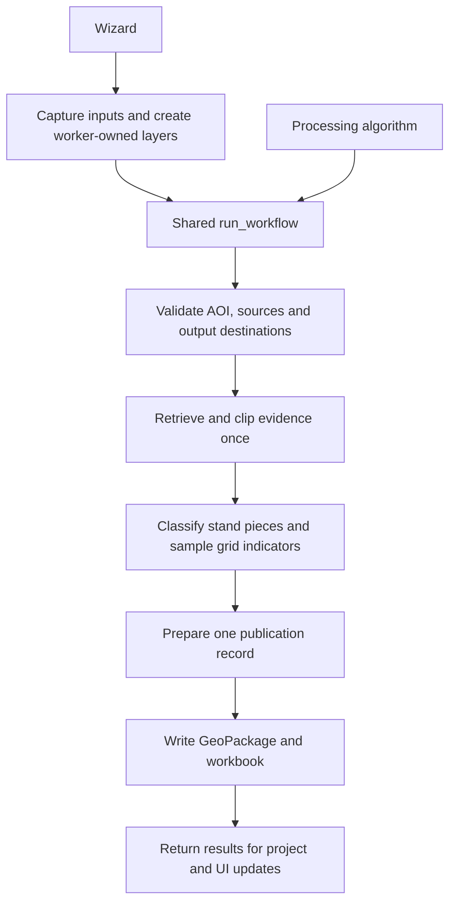

# Implemented architecture

The plugin prepares spatial evidence and descriptive forest indicators for a separate value-table model. It is an unfinished personal prototype; the public use case and its limits are explained in [project context](../project-context.md) and [ADR-0001](adr/0001-spatial-input-preparation-boundary.md).

## System diagram

Open the [full-size diagram](technical-architecture.svg), or edit the [Draw.io source](technical-architecture.drawio) in Draw.io / diagrams.net. Solid arrows show calls or evidence flow. The dashed downstream handoff describes intended use by a separate value-table model; the plugin does not execute that model.

## Deployment and runtime

This is a Python plugin running inside QGIS Desktop. QGIS supplies Python, Qt/PyQt, geometry operations, coordinate transformations and vector providers. There is no application server or server-side analysis worker in this repository. The external runtime connections are data-provider services; results and operational logs are written locally. The declared target is QGIS 4.2.3 and newer 4.x releases, as recorded in [metadata.txt](../../qgis_plugin/savonia_responsible_forest_planning_tool/metadata.txt); QGIS 4.2.3 remains the verification baseline.

QGIS loads the plugin through [`classFactory(iface)`](../../qgis_plugin/savonia_responsible_forest_planning_tool/__init__.py). The [plugin lifecycle](../../qgis_plugin/savonia_responsible_forest_planning_tool/ui/plugin.py) registers the Processing provider, menus, dock and logging handlers, and removes its registrations/handlers on unload. Source setup discovers managed WFS products and adds configured layers to the current project through [project_setup.py](../../qgis_plugin/savonia_responsible_forest_planning_tool/adapters/project_setup.py).

## One execution path

The wizard and Processing algorithm both call `run_workflow(parameters, feedback)`. The wizard reaches it through `ForestAnalysisTask`; it does not invoke the Processing algorithm. The orchestrator copies the caller's parameters, creates a run ID, records stage progress and outcomes, and passes explicit results between validation, retrieval, classification and publication. Processing supplies the toolbox/batch/modeler interface; the wizard supplies choices and presentation. See [ADR-0002](adr/0002-shared-processing-workflow.md) and the [workflow implementation](../../qgis_plugin/savonia_responsible_forest_planning_tool/analysis/workflow.py).

The five orchestrated stages are validation, source retrieval, spatial classification, output preparation and output writing. Grid sampling runs inside spatial classification. It intersects inventory cells with each classified forest polygon and retains per-metric sufficient statistics for later aggregation; it does not create a second set of classification boundaries. See [spatial_classification.py](../../qgis_plugin/savonia_responsible_forest_planning_tool/analysis/workflow_steps/spatial_classification.py) and [grid_sampling.py](../../qgis_plugin/savonia_responsible_forest_planning_tool/analysis/workflow_steps/grid_sampling.py).

## Module ownership

| Boundary | Responsibility and owning implementation |
| --- | --- |
| Pure evidence policy | [classification.py](../../qgis_plugin/savonia_responsible_forest_planning_tool/analysis/classification.py) interprets normalized source values and assembles piece-level classes, rule/source IDs and indicator/status values. It receives scalar area and evidence rather than widgets or QGIS project state. |
| Pure field contract | [source_readiness.py](../../qgis_plugin/savonia_responsible_forest_planning_tool/analysis/source_readiness.py) resolves required fields and aliases by semantic source ID. |
| Pure calculations | [domain.py](../../qgis_plugin/savonia_responsible_forest_planning_tool/analysis/domain.py) owns stand mappings and summaries; [grid_indicators.py](../../qgis_plugin/savonia_responsible_forest_planning_tool/analysis/grid_indicators.py) owns grid statistics. |
| Workflow phases | [workflow_steps](../../qgis_plugin/savonia_responsible_forest_planning_tool/analysis/workflow_steps/) owns validation, QGIS geometry/retrieval, spatial classification, grid sampling and publication coordination. |
| QGIS adapters | [adapters](../../qgis_plugin/savonia_responsible_forest_planning_tool/adapters/) owns service discovery, project setup, provider-layer checks, result-layer construction, and separate GeoPackage/XLSX writers. |
| Presentation | [ui](../../qgis_plugin/savonia_responsible_forest_planning_tool/ui/), [Processing provider](../../qgis_plugin/savonia_responsible_forest_planning_tool/processing/provider.py), and [i18n.py](../../qgis_plugin/savonia_responsible_forest_planning_tool/i18n.py) adapt choices, labels, progress, help and errors. |

Split modules around coherent responsibilities and deliberate public interfaces. Keep closely related helpers local, imports explicit and package initialization light. File length and one-class-per-file rules do not define the boundaries. This is project design guidance informed by [Python modules/packages](https://docs.python.org/3/tutorial/modules.html), [the import system](https://docs.python.org/3/reference/import.html), and [PEP 8 public interfaces](https://peps.python.org/pep-0008/#public-and-internal-interfaces).

## QGIS and thread boundary

Packaged `metadata.txt` remains authoritative for the installation range. Use the selected QGIS release's bundled Python, Qt and PyQt for runtime checks, starting with the 4.2.3 baseline. The shared workflow is synchronous inside its execution context. The wizard captures worker-safe inputs and constructs worker-owned providers; project and widget changes belong at the UI boundary. A caller must not pass live GUI-owned layers or widgets into a worker. See [wizard implementation](../../qgis_plugin/savonia_responsible_forest_planning_tool/ui/wizard.py), [source retrieval](../../qgis_plugin/savonia_responsible_forest_planning_tool/analysis/workflow_steps/source_loading.py), and [QGIS task guidance](https://docs.qgis.org/4.2/en/docs/pyqgis_developer_cookbook/tasks.html).

Specifically, [`capture_worker_inputs`](../../qgis_plugin/savonia_responsible_forest_planning_tool/analysis/worker_task.py) copies AOI geometries as WKB, source provider descriptions, selected-source feature snapshots when applicable, and the coordinate transform context on the main thread. `ForestAnalysisTask.run()` rebuilds the AOI and source layers in the worker. When the task finishes, the wizard's main-thread callback reopens the saved GeoPackage and adds result views and clipped source snapshots to the project. Processing instead sets `NoThreading` because it receives live layer objects; it calls the same synchronous workflow with an explicit transform context from Processing.

Processing feedback carries progress and cancellation; worker use does not create a second analysis implementation.

## Geometry, evidence and publication boundaries

The AOI is dissolved and transformed to EPSG:3067. Returned polygons are transformed, repaired when possible, clipped, and retained as source snapshots with original attributes and identifiers. Classification uses stand pieces, while grid intersections provide independent indicator evidence. Geometry thresholds, criterion membership and result fields are specified in the [calculation reference](calculations.md#area-and-geometry) and [ADR-0004](adr/0004-stand-based-sensitivity-classification.md).

All eight required sources must pass validation. Request failures, missing required fields, unusable geometries/transforms, uninterpretable classification values, and invariant violations stop publication. Missing individual numeric indicator values may instead produce partial/unknown metrics. Pure classification still defines positive-match precedence and `UNKNOWN` for unavailable dependencies; that policy does not mean the current application continues after a required-source failure. See [ADR-0006](adr/0006-evidence-coverage-and-publication.md).

One prepared publication record supplies a GeoPackage containing result polygons, source snapshots, coverage and metadata, and a workbook containing tier/class summaries, coverage and notes. Dedicated writers serialize each format; the publishing phase coordinates writes and removes partial outputs on failure. This is application cleanup rather than a filesystem transaction. [Publishing implementation](../../qgis_plugin/savonia_responsible_forest_planning_tool/analysis/workflow_steps/publishing.py).

The GeoPackage writer uses QGIS to write spatial layers and nonspatial metadata tables. The workbook writer builds XLSX XML and ZIP parts using Python's standard library, so it does not require Excel or a separate spreadsheet package. Existing output names are rejected before writing. On a caught write failure or cancellation during publication, cleanup attempts to remove both files; deletion can fail, and a process crash is outside that cleanup guarantee. See [GeoPackage writer](../../qgis_plugin/savonia_responsible_forest_planning_tool/adapters/geopackage_writer.py), [workbook writer](../../qgis_plugin/savonia_responsible_forest_planning_tool/adapters/excel_writer.py), and [destination validation](../../qgis_plugin/savonia_responsible_forest_planning_tool/analysis/workflow_steps/validation.py).

## Data flow and policy boundaries

The [source registry](../../qgis_plugin/savonia_responsible_forest_planning_tool/adapters/sources.py) defines three Metsäkeskus products and five SYKE products. QGIS WFS providers retrieve evidence for the AOI; provider errors are checked separately from a successful empty response. Required provider field names are resolved into a normalized source contract once. Retrieved geometries and original attributes are retained as clipped snapshots so exported evidence can be reviewed later. Source availability, geographic completeness and valid metric coverage remain separate concepts; see [data sources](data-sources.md).

Pure policy modules interpret normalized attributes, choose sensitivity criteria and calculate indicators without widgets or QGIS project state. The QGIS workflow phases perform geometry operations and call that policy. AOI-clipped source stands remain the parent units; relevant criterion boundaries divide them into classified forest polygons. Every polygon carries classes for all six sensitivity tiers. Grid estimates contribute independent volume, age, soil and drainage indicators, with separate valid/unknown areas for each metric. Stand and grid volume estimates retain their own denominators. The [indicator design](indicators.md) and [calculation reference](calculations.md) define the detailed rules.

## Logging, language and verification

[`app_logging.py`](../../qgis_plugin/savonia_responsible_forest_planning_tool/app_logging.py) separates technical diagnostics from business-action records. Both live in the QGIS per-user settings area, with 2 MiB rotation and three backups: `technical.log` retains detailed diagnostics, while `business-actions.jsonl` retains structured operation outcomes. Selected concise diagnostics also reach QGIS Log Messages. Run IDs connect workflow stages and output metadata. These local operational records serve a different purpose from the durable evidence saved in a result pair.

[`i18n.py`](../../qgis_plugin/savonia_responsible_forest_planning_tool/i18n.py) selects Finnish for a Finnish QGIS locale and English otherwise. The entry point resolves a run's language and passes it into progress, errors and exported presentation text; stable source IDs, classification codes and field names remain language-neutral. [`documentation.py`](../../qgis_plugin/savonia_responsible_forest_planning_tool/documentation.py) resolves packaged bilingual HTML help. These are presentation services around the shared workflow.

Verification follows these boundaries: [ordinary unit tests](../../qgis_plugin/tests/) cover pure policy, workbook serialization, rounding and translations; [PyQGIS tests](../../qgis_plugin/tests/qgis/) exercise adapters, the Processing workflow, persisted outputs and UI integration with local fixtures. Packaged load/run/unload and Finnish/English GUI checks require the supported QGIS runtime. See the [required testing guidance](../agents/qgis.md#testing-and-debugging) and [development guide](development.md).

Remaining provider and QGIS runtime acceptance checks are maintained in [open questions](open-questions.md).
