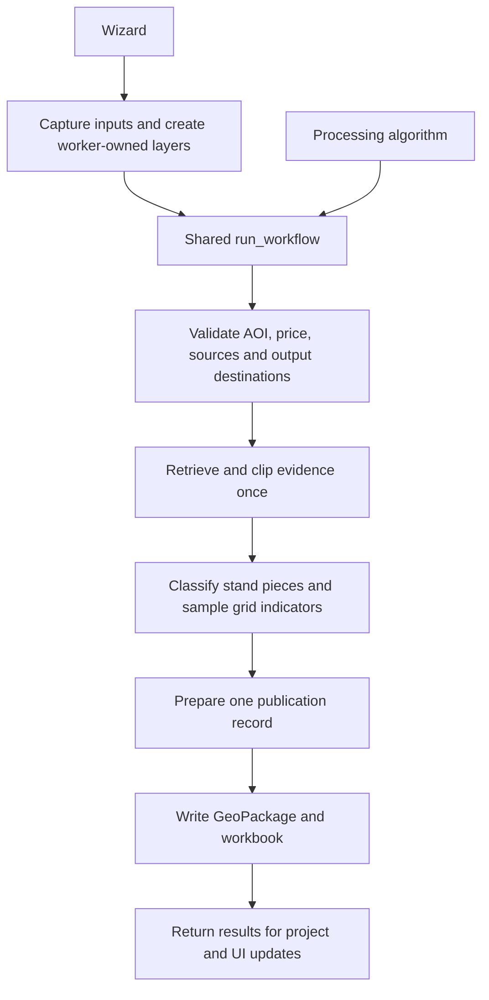

# Implemented architecture

The plugin prepares spatial evidence and descriptive forest indicators for a separate value-table model. It is an unfinished personal prototype; the public use case and its limits are explained in [project context](../project-context.md) and [ADR-0001](adr/0001-spatial-input-preparation-boundary.md).

## System diagram

Open the [full-size diagram](technical-architecture.svg), or edit the [Draw.io source](technical-architecture.drawio) in Draw.io / diagrams.net. Solid arrows show calls or evidence flow. The dashed downstream handoff describes intended use by a separate value-table model; the plugin does not execute that model.

## Deployment and runtime

This is a Python plugin running inside QGIS Desktop. QGIS supplies Python, Qt/PyQt, geometry operations, coordinate transformations and vector providers. There is no application server or server-side analysis worker in this repository. The external runtime connections are data-provider services; results and operational logs are written locally. The declared target is QGIS 3.44 and newer 3.x/4.x releases, as recorded in [metadata.txt](../../qgis_plugin/savonia_responsible_forest_planning_tool/metadata.txt). The verification baselines are QGIS 3.44.0 with Qt 5 and QGIS 4.2.3 with Qt 6; other permitted releases need their own runtime checks.

Plugin initialization owns Processing, menu/dock and logging registrations;
unload releases those resources and cancels active analysis. Project setup is
an adapter that discovers and configures source layers in the current project.
Only current-development project configuration and output formats are supported;
earlier plugin formats have no migration guarantee.

## One execution path

The wizard and Processing algorithm both call `run_workflow(parameters, feedback)`. The wizard reaches it through `ResponsibleForestPlanningAnalysisTask`; it does not invoke the Processing algorithm. The orchestrator copies the caller's parameters, creates a run ID, records stage progress and outcomes, and passes explicit results between validation, retrieval, classification and publication. Processing supplies the toolbox/batch/modeler interface; the wizard supplies choices and presentation. See [ADR-0002](adr/0002-shared-processing-workflow.md) and the [workflow implementation](../../qgis_plugin/savonia_responsible_forest_planning_tool/analysis/workflow.py).

The workflow validates inputs, retrieves evidence, classifies stand pieces and
samples indicators, then prepares and writes one publication. Grid intersections
supply indicator statistics without creating classification boundaries.

## Module ownership

| Boundary | Responsibility and owning implementation |
| --- | --- |
| Pure evidence policy | [classification.py](../../qgis_plugin/savonia_responsible_forest_planning_tool/analysis/classification.py) interprets normalized source values and assembles piece-level classes, criterion checks, rule/source IDs and indicators with metric coverage. It receives scalar area and evidence rather than widgets or QGIS project state. |
| Pure field contract | [source_readiness.py](../../qgis_plugin/savonia_responsible_forest_planning_tool/analysis/source_readiness.py) resolves required fields and aliases by semantic source ID. |
| Pure calculations | [domain.py](../../qgis_plugin/savonia_responsible_forest_planning_tool/analysis/domain.py) owns stand mappings and summaries; [grid_indicators.py](../../qgis_plugin/savonia_responsible_forest_planning_tool/analysis/grid_indicators.py) owns grid statistics. |
| Workflow phases | [workflow_steps](../../qgis_plugin/savonia_responsible_forest_planning_tool/analysis/workflow_steps/) owns validation, QGIS geometry/retrieval, spatial classification, grid sampling and publication coordination. |
| QGIS adapters | [adapters](../../qgis_plugin/savonia_responsible_forest_planning_tool/adapters/) owns service discovery, project setup, provider-layer checks, result-layer construction, and separate GeoPackage/XLSX writers. |
| Presentation | [ui](../../qgis_plugin/savonia_responsible_forest_planning_tool/ui/), [Processing provider](../../qgis_plugin/savonia_responsible_forest_planning_tool/processing/provider.py), and [i18n.py](../../qgis_plugin/savonia_responsible_forest_planning_tool/i18n.py) adapt choices, labels, progress, help and errors. |

## QGIS and thread boundary

The shared workflow runs synchronously in its caller's execution context.
The wizard captures AOI geometry, selected-source snapshots, provider connection
descriptions, parameters and transform context on the main thread. Its task
reconstructs worker-owned layers; widgets, GUI-owned layers and `QgsProject`
remain on the main thread. Completion returns saved outputs and warnings for
project/UI updates. Unload cancels the task and detaches its UI callback without
blocking the GUI thread.

Processing receives live layers and uses `NoThreading`; it calls the same
workflow with an explicit transform context. Both entry points carry progress,
cancellation and completion warnings across their boundary. This ownership
model keeps asynchronous execution from becoming a separate analysis path.
See the [worker adapter](../../qgis_plugin/savonia_responsible_forest_planning_tool/analysis/worker_task.py)
and [QGIS guidance](../agents/qgis.md#architecture-and-qgis-practices).

## Geometry, evidence and publication boundaries

The AOI is dissolved and transformed to EPSG:3067. Returned polygons are transformed, repaired when possible, clipped, and retained as source snapshots with original attributes and identifiers. Classification uses stand pieces, while grid intersections provide independent indicator evidence. Use the [geometry contract](calculations.md#area-and-geometry), [functional tier rules](../specs/classification.md#cl-02-six-cumulative-tiers) and [output schema](output-schema.md) for details; [ADR-0004](adr/0004-stand-based-sensitivity-classification.md) records the rationale.

All eight required sources must pass validation. Request failures, missing required fields, unusable geometries/transforms, uninterpretable protected/habitat/programme classification values, and invariant violations stop publication. Missing individual numeric indicator values may instead produce partial/unknown metrics. Missing or invalid individual stand ages produce unknown age evidence under [CL-03](../specs/classification.md#cl-03-classes-and-evidence-policy). Pure classification still defines positive-match precedence and `UNKNOWN` for unavailable dependencies; that policy does not mean the current application continues after a required-source failure. See [ADR-0006](adr/0006-evidence-coverage-and-publication.md).

One prepared publication record supplies a GeoPackage containing result polygons, source snapshots, coverage and metadata, and a workbook containing tier/class summaries, coverage and notes. Dedicated writers serialize each format; the publishing phase coordinates writes and removes partial outputs on failure. This is application cleanup rather than a filesystem transaction. [Publishing implementation](../../qgis_plugin/savonia_responsible_forest_planning_tool/analysis/workflow_steps/publishing.py).

QGIS writes the GeoPackage; the workbook writer uses standard-library ZIP/XML,
so export requires neither Excel nor an external spreadsheet package. Existing
output names are rejected before writing. Caught write failures or cancellation
trigger cleanup of both outputs; deletion can fail and a process crash is
outside that guarantee. See the [publication coordinator](../../qgis_plugin/savonia_responsible_forest_planning_tool/analysis/workflow_steps/publishing.py).

Required GeoPackage field/form presentation is saved through the QGIS 3.44
error-string API or the QGIS 4 structured-result API, selected in the
[GeoPackage adapter](../../qgis_plugin/savonia_responsible_forest_planning_tool/adapters/geopackage_writer.py).
Either API reporting an error stops paired publication; both baselines check
the saved presentation after reopening the file.
[QGIS 3.44 style API](https://api.qgis.org/api/3.44/classQgsMapLayer.html),
[QGIS 4 style API](https://api.qgis.org/api/4.0/classQgsMapLayer.html).

## Data flow and policy boundaries

The [source registry](../../qgis_plugin/savonia_responsible_forest_planning_tool/adapters/sources.py) defines three Metsäkeskus products and five SYKE products. QGIS WFS providers retrieve evidence for the AOI; provider errors are checked separately from a successful empty response. Required provider field names are resolved into a normalized source contract once. Retrieved geometries and original attributes are retained as clipped snapshots so exported evidence can be reviewed later. Source availability, geographic completeness and valid metric coverage remain separate concepts; see [data sources](data-sources.md).

Pure policy modules interpret normalized attributes, choose sensitivity criteria and calculate indicators without widgets or QGIS project state. The QGIS workflow phases perform geometry operations and call that policy. AOI-clipped source stands remain the parent units; relevant criterion boundaries divide them into classified forest polygons. Every polygon carries classes for all six sensitivity tiers. Grid estimates contribute independent volume, age, soil and drainage indicators, with separate valid/unknown areas for each metric. Stand and grid volume estimates retain their own denominators. The [indicator calculations](indicator-calculations.md) define aggregation; [indicator design](indicators.md) explains evidence limits.

## Logging, language and verification

[`app_logging.py`](../../qgis_plugin/savonia_responsible_forest_planning_tool/app_logging.py) separates technical diagnostics from business-action records. The [logging contract](operations.md#logging) owns channel payloads, destinations, rotation and lifecycle. Selected concise diagnostics also reach QGIS Log Messages. Run IDs connect workflow stages and output metadata. These local operational records serve a different purpose from the durable evidence saved in a result pair.

[`i18n.py`](../../qgis_plugin/savonia_responsible_forest_planning_tool/i18n.py) selects Finnish for a Finnish QGIS locale and English otherwise. The entry point resolves a run's language and passes it into progress, errors and exported presentation text; stable source IDs, classification codes and field names remain language-neutral. [`documentation.py`](../../qgis_plugin/savonia_responsible_forest_planning_tool/documentation.py) resolves packaged bilingual HTML help. These are presentation services around the shared workflow.

Verification follows these boundaries: [ordinary unit tests](../../qgis_plugin/tests/) cover pure policy, workbook serialization, rounding and translations; [PyQGIS tests](../../qgis_plugin/tests/qgis/) exercise adapters, the Processing workflow, persisted outputs and UI integration with local fixtures. Packaged load/run/unload and Finnish/English GUI checks require the supported QGIS runtime. See the [required testing guidance](../agents/qgis.md#testing-and-debugging) and [development guide](development.md).

Remaining provider and QGIS runtime acceptance checks are maintained in [open questions](../open-questions.md).
