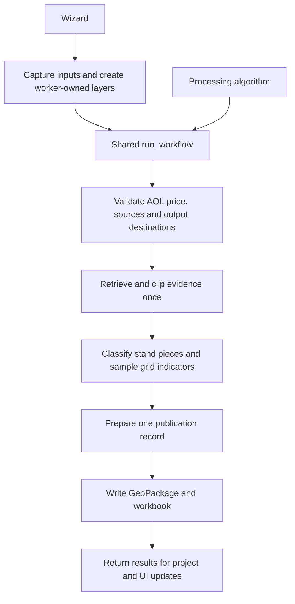

# Implemented architecture

The plugin prepares spatial evidence and descriptive forest indicators for a separate value-table model. It is an unfinished personal prototype; the public use case and its limits are explained in [project context](../project-context.md) and [ADR-0001](adr/0001-spatial-input-preparation-boundary.md).

## System diagram

Open the [full-size diagram](technical-architecture.svg), or edit the [Draw.io source](technical-architecture.drawio) in Draw.io / diagrams.net. Solid arrows show calls or evidence flow. The dashed downstream handoff describes intended use by a separate value-table model; the plugin does not execute that model.

## Deployment and runtime

This is a Python plugin running inside QGIS Desktop. QGIS supplies Python, Qt/PyQt, geometry operations, coordinate transformations and vector providers. There is no application server or server-side analysis worker in this repository. The external runtime connections are data-provider services; results and operational logs are written locally. The declared target is QGIS 3.44 and newer 3.x/4.x releases, as recorded in [metadata.txt](../../qgis_plugin/savonia_responsible_forest_planning_tool/metadata.txt). The verification baselines are QGIS 3.44.0 with Qt 5 and QGIS 4.2.3 with Qt 6; other permitted releases need their own runtime checks.

Plugin initialization owns Processing, menu/dock and logging registrations;
unload releases those resources and cancels active analysis. Project setup is
an adapter that discovers and configures source layers in the current project.
Only current-development project configuration and output formats are supported;
earlier plugin formats have no migration guarantee.

## One execution path

The wizard and Processing algorithm both call `run_workflow(parameters, feedback)`. The wizard reaches it through `ResponsibleForestPlanningAnalysisTask`; it does not invoke the Processing algorithm. The orchestrator copies the caller's parameters, creates a run ID, records stage progress and outcomes, and passes explicit results between validation, retrieval, classification and publication. Processing supplies the toolbox/batch/modeler interface; the wizard supplies choices and presentation. See [ADR-0002](adr/0002-shared-processing-workflow.md) and the [workflow implementation](../../qgis_plugin/savonia_responsible_forest_planning_tool/analysis/workflow.py).

### AOI-wide working set

Retrieval completes for all required sources before stand classification and
indicator calculation begin. It transforms, repairs, clips and buffers evidence
as it arrives, accumulating source records and memory-layer snapshots for the
whole AOI, then builds the grid sampler's in-memory spatial index. Classification
iterates over stand pieces sequentially against that retained evidence and
accumulates result rows for publication. WFS paging does not make this a bounded
fetch/calculate/release pipeline.

The workflow has no application-level AOI-size, retained-feature or memory-budget
guard. Large areas, particularly those containing many grid cells, can exhaust
memory and potentially crash the QGIS process. The wizard's background task
preserves UI responsiveness but does not bound the analysis working set.
[ADR-0019](adr/0019-aoi-wide-in-memory-analysis.md) records this prototype trade-off
and the deferred production direction of bounded geometry-level work with
limited parallelism.

## Module ownership

| Boundary | Responsibility and owning implementation |
| --- | --- |
| Pure evidence policy | [classification.py](../../qgis_plugin/savonia_responsible_forest_planning_tool/analysis/classification.py) interprets normalized source values and assembles piece-level classes, criterion checks, rule/source IDs and indicators with metric coverage. It receives scalar area and evidence rather than widgets or QGIS project state. |
| Pure field contract | [source_readiness.py](../../qgis_plugin/savonia_responsible_forest_planning_tool/analysis/source_readiness.py) resolves required fields and aliases by semantic source ID. |
| Pure calculations | [domain.py](../../qgis_plugin/savonia_responsible_forest_planning_tool/analysis/domain.py) owns stand mappings and summaries; [grid_indicators.py](../../qgis_plugin/savonia_responsible_forest_planning_tool/analysis/grid_indicators.py) owns grid statistics. |
| Workflow phases | [workflow_steps](../../qgis_plugin/savonia_responsible_forest_planning_tool/analysis/workflow_steps/) owns validation, QGIS geometry/retrieval, spatial classification, grid sampling and publication coordination. |
| QGIS adapters | [adapters](../../qgis_plugin/savonia_responsible_forest_planning_tool/adapters/) owns service discovery, project setup, provider-layer checks, result-layer construction, and separate GeoPackage/XLSX writers. |
| Presentation | [ui](../../qgis_plugin/savonia_responsible_forest_planning_tool/ui/), [Processing provider](../../qgis_plugin/savonia_responsible_forest_planning_tool/processing/provider.py), and [i18n.py](../../qgis_plugin/savonia_responsible_forest_planning_tool/i18n.py) adapt choices, labels, progress, help and errors. |

## QGIS and thread boundary

The shared workflow runs synchronously in its caller's execution context.
The wizard captures AOI geometry, selected-source snapshots, provider connection
descriptions, parameters and transform context on the main thread. Its task
reconstructs worker-owned layers; widgets, GUI-owned layers and `QgsProject`
remain on the main thread. Completion returns saved outputs and warnings for
project/UI updates. Unload cancels the task and detaches its UI callback without
blocking the GUI thread.

Processing receives live layers and uses `NoThreading`; it calls the same
workflow with an explicit transform context. Both entry points carry progress,
cancellation and completion warnings across their boundary. This ownership
model keeps asynchronous execution from becoming a separate analysis path.
See the [worker adapter](../../qgis_plugin/savonia_responsible_forest_planning_tool/analysis/worker_task.py)
and [QGIS guidance](../agents/qgis.md#architecture-and-qgis-practices).

## Failure and publication boundaries

All eleven required sources must pass validation. Request failures, missing required fields, unusable geometries/transforms, uninterpretable protected/habitat/programme classification values, and invariant violations stop publication. Missing individual numeric indicator values may instead produce partial/unknown metrics. Missing or invalid individual stand ages produce unknown age evidence under [CL-03](../specs/classification.md#cl-03-classes-and-evidence-policy). Pure classification still defines positive-match precedence and `UNKNOWN` for unavailable dependencies; that policy does not mean the current application continues after a required-source failure. See [ADR-0006](adr/0006-evidence-coverage-and-publication.md).

One publication record supplies a GeoPackage with result polygons, source
snapshots, coverage and metadata, plus a workbook with tier/class summaries,
coverage and notes. Dedicated writers serialize each format. The coordinator
cleans up partial outputs after caught write failures or cancellation, but this
is not a filesystem transaction; cleanup can fail, and a process crash is
outside the guarantee. Existing output names are rejected before writing. See
the [publication coordinator](../../qgis_plugin/savonia_responsible_forest_planning_tool/analysis/workflow_steps/publishing.py).

The [geometry contract](calculations.md) owns spatial operations and tolerances.
[Source-layer requirements](source-layer-requirements.md) and [data sources](data-sources.md)
own provider inputs and retrieval; [output schema](output-schema.md) owns
published fields and coverage. Classification uses stand pieces, while grid
intersections provide independent indicator evidence, as recorded in
[ADR-0004](adr/0004-stand-based-sensitivity-classification.md).

## Logging, language and verification

Logging, language selection and help are presentation and operational services
around the shared workflow. Their policies belong to [operations](operations.md).
Verification boundaries and repeatable checks belong to the [QGIS guidance](../agents/qgis.md#testing-and-debugging)
and [development guide](development.md); automated checks do not establish
interactive or live-provider acceptance.
